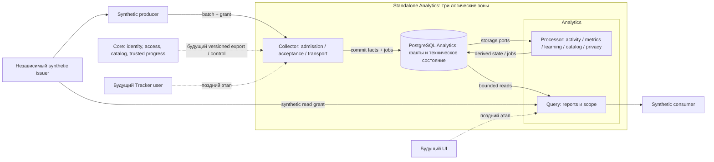

# CORP-57: границы Analytics

Статус: **архитектурный контракт, реализация и runtime не проверены**. Снимок: 16.11.2026, ветка `feach/Analitick`, HEAD `f787672ff2639434f0be331d05def5d8f31b3c1e` и существующее грязное рабочее дерево. Целевые пути, порты и схемы ниже являются проектом; работа CORP-57 сама по себе не создаёт сервис или инфраструктуру. Проверки и их статус — в [architecture-checks.md](architecture-checks.md).

## Подтверждённая база и границы

* [План Analytics](../architecture/ANALYTICS_SERVICE_PLAN_20261115.md#L18-L53) определяет три зоны Collector / Analytics / PostgreSQL Analytics, одну общую `activity_facts`, владельца неизменяемого payload и независимые процессы. [Обновление плана](../architecture/ANALYTICS_PLAN_UPDATE_20261116.md#L5-L13) подтверждает синтетический первый этап и границы следующих этапов.
* В текущих исходниках Core уже есть `user_activity_days`, `user_lesson_progress`, `user_task_progress` ([models.py:135](../../services/core-api/pymentor_core/adapters/sql/models.py#L135)); HTTP календаря и summary использует прежнюю активность ([router.py:128](../../services/core-api/pymentor_core/modules/identity/api/router.py#L128)), прогресс имеет собственный фасад Core ([progress.py:23](../../services/core-api/pymentor_core/modules/learning/progress.py#L23)). Старые дни не превращаются автоматически в минуты или посещения курсов.
* В текущем рабочем дереве миграция `c528_course_leaders` добавляет lifecycle-pinned binding ([c528:5](../../services/core-api/migrations/versions/c528_course_leaders.py#L5)); проверка привязки и действующего назначения находится в Core ([course_leader_config.py:14](../../services/core-api/pymentor_core/adapters/sql/course_leader_config.py#L14)). Наличие кода не доказывает состояние любого развёртывания. Назначения, roster и авторитетный доступ остаются в Core.
* Локальный Core compose — disposable профиль с PostgreSQL 17 и Redis ([compose.yaml:1](../../infra/local-postgres-redis/compose.yaml#L1)); существующий Helm Core имеет отдельные настройки ресурсов и probes ([deployment-core.yaml:9](../../infra/helm/pymentor/templates/deployment-core.yaml#L9)). Это не существующая инфраструктура Analytics. Данные локальной Core DB не исследуются и не изменяются.
* Текущий AppProject ограничивает destination и разрешённые ресурсы ([project.yaml:7](../../infra/gitops/bootstrap/app/project.yaml#L7)); существующие data-egress правила предназначены для текущих компонентов ([networkpolicy.yaml:100](../../infra/helm/pymentor/templates/networkpolicy.yaml#L100)). Независимому release понадобятся отдельные согласованные bootstrap, права и network policy. Настроенные quotas сами по себе не доказывают свободную ёмкость. Фактический способ доставки preview необходимо проверять отдельно; один Helm chart не доказывает фактический runtime rollout.

## C4: контекст и контейнеры



Сплошные стрелки — проектируемый синтетический стенд, не подтверждение существующего исполнения. Core producer/export/control, реальный Tracker и UI не подключаются на первом этапе. В дальнейшем Core producer пишет отдельный analytics outbox в своей бизнес-транзакции, relay доставляет at-least-once с ограниченным бюджетом; notification outbox не переиспользуется. Login/navigation/submit/progress Core не выполняют синхронный вызов Analytics в бизнес-транзакции. Окно автономности и исчерпание диска рассчитывает CORP-113; бесконечная независимость не обещается.

## Ownership и зависимости

| Владелец | Вход и выход | Граница и потребители |
| --- | --- | --- |
| Collector `admission` | Доверенный grant/source, версия и лимиты → допустимый subject/scope | Только user для учебной telemetry; server-owned subject, отдельный trusted control source; тело не задаёт права |
| Collector `acceptance` | Namespace producer + event ID + canonical payload hash → accepted/duplicate/conflict | Единственный записывает immutable activity payload; атомарно с необходимыми jobs; ACK после commit |
| Collector `transport` | Versioned batch → per-item результат, backpressure | Не рассчитывает KPI и не выдаёт отчёты; 429/Retry-After и 503, limits и неподдерживаемую версию детализирует CORP-58 |
| Analytics `activity` | Facts → детерминированные неперекрывающиеся интервалы subject | Idle 300 секунд, theory/practice; объединение по всем устройствам и курсам; детальные golden cases CORP-59 |
| Analytics `metrics` | Интервалы/факты → версии посетителей и времени | Distinct subject, ограниченные периоды; на старте нет обязательных rollup или таблиц по курсам |
| Analytics `learning` | Только versioned доверенный Core export/read contract → проекция прогресса | Core остаётся источником истины; таймер и browser event не подтверждают завершение |
| Analytics `catalog` | Минимальный versioned manifest Core → идентичности/aliases | Product course ID + lesson ID + catalog version; неизвестные версии ожидают или помещаются в quarantine; без монтирования материалов |
| Analytics `privacy` | Trusted control → tombstone/epoch, deletion и restore barrier | Проверяется при admission, worker commit и query; старый lifecycle нельзя оживить replay или восстановлением |
| Analytics `reports` | Публичные порты metrics/learning/catalog + grant → scoped DTO | User — себя; leader — назначенный курс и разрешённый booking roster; admin — учебные данные в разрешённом scope; freshness источников отдельно |
| PostgreSQL Analytics | Факты, технические jobs/fences/checkpoints и при необходимости восстанавливаемые производные данные | Собственная logical DB, migration history и ограниченные роли; владелец payload остаётся Collector |

Зависимости направлены на опубликованные versioned DTO/порты, не на HTTP handlers или ORM другого модуля. Запрещены Core imports, межсервисные SQL/FK/FDW, Core Redis sessions и монтирование кода/материалов курсов. Изменение публичного контракта требует fixtures потребителей. `activity_facts` — общий первичный источник новой активности всех курсов, не универсальный источник Core progress, bookings и accounts. Идентификатор учебной сессии не является auth session ID; факты не содержат токенов, контактов, исходного кода или ответов.

## Целевой layout и порты

```text
services/analytics/
  pymentor_analytics/
    app/                    # composition + collector / processor / query
    modules/collector/      # api, application, domain, ports
    modules/analytics/      # activity, metrics, learning, reports, catalog, privacy
    adapters/               # PostgreSQL, verifier, telemetry
    shared/                 # только общие стабильные типы
  contracts/                # schemas, DTO, versioned consumer fixtures
  migrations/               # отдельная history / migrator
  tests/                    # module, contract, architecture, recovery
  Dockerfile                # отдельные команды процессов и migration
infra/helm/analytics/       # отдельный release (будущее)
infra/gitops/analytics/     # самостоятельная доставка (будущее)
```

| Публичный порт | Контракт и владелец | Граница транзакции / потребитель |
| --- | --- | --- |
| Batch intake | Collector: проверенный source/subject, versioned item, namespace + event_id | Один принятый item: уникальность ключа и hash, immutable факт и обязательные downstream jobs в одной транзакции; ответ после commit. Same key/hash → duplicate, изменённый hash → conflict; server `received_at` не входит в hash |
| Accepted facts read | Collector storage contract: immutable payload и идентичность, версии и время приёма | Analytics читает без прямых импортов и права менять исходный payload; повторный расчёт меняет только собственные результаты/техническое состояние |
| Work claim/commit | Analytics processor port: consumer identity/version, partition, lease generation, bounded batch | Claim, fenced commit, ack/dedup, эффекты и downstream technical jobs под транзакционным контролем, описанным ниже |
| Calculation / report | Analytics activity/metrics/learning предоставляют versioned DTO reports | Query применяет server-side ACL и bounded filters; отдельно сообщает freshness и unavailable, не подменяет progress таймером |
| Control / catalog / progress | Отдельные доверенные versioned DTO/credentials, Core — владелец исходной истины | Synthetic equivalents на первом этапе; до real integration схемы и права согласуются в CORP-58/60/69 |

На внешней границе будущего release допускаются только `/api/analytics/events/batch` и `/api/analytics/reports/*`; processor, storage и control endpoints не публикуются. Verify подписи grant локальный, с allowlist, issuer/audience/expiry/not-before/key ID/subject/scope и перекрытием ключей; нет per-request Core introspection или доступа к Redis sessions. Контракт CORP-69 ограничивает collection grant до 300 секунд, report grant до 60 секунд; подтверждение удаления до 60 секунд, privacy lag до 5 секунд и heartbeat до 15 секунд. Исполнение этих границ проверяется отдельно от документа. Synthetic issuer независим от Core и использует отдельные synthetic credentials.

## Очередь, порядок и recovery

Общие verified-identity DTO и privacy ports определены в
`pymentor_analytics/contracts/auth_v1.py`. Бизнес-модули зависят от этого
контракта; JWT/HTTP/PostgreSQL adapters подключаются composition root.
Старые пути импорта auth DTO сохранены как совместимые экспорты.

Транспорт первого профиля — PostgreSQL Analytics, без обязательного внешнего брокера. Partition key для activity — **целый `subject_ref` lifecycle**, а не course, session или device: все интервалы одного субъекта попадают в одну стабильную partition, чтобы межкурсовые пересечения нормализовались вместе. Изменение числа partition или алгоритма hash требует versioned migration/drain и сохранения identity, не незаметной перенастройки. Порядок обработки событий внутри subject детерминирован с tie-break; late/offline события запускают ограниченный пересчёт затронутого окна, не отбрасываются одним high watermark.

Consumer identity/version и checkpoints независимы для activity live, replay и privacy/control; каждый имеет собственные bounded concurrency и budget. Privacy/control получает зарезервированную ёмкость и приоритет так, чтобы backlog activity/replay не блокировал deletion barrier; конкретные бюджеты и сигналы saturation определяются в CORP-113. Получение кандидата работы не должно удерживать partition lease, ожидая subject lock. Все транзакции, которым нужны оба ресурса, берут конфликтующий **subject fence сначала, затем partition lease**, проверяют subject epoch и актуальный generation lease под этими locks и только тогда коммитят эффекты. Takeover увеличивает generation; устаревший worker не может записать или ACK. Delete/Query используют совместимые конфликтующие locks или эквивалентный доказанный CAS; внешние эффекты требуют отдельной надёжной границы.

В одном PostgreSQL transaction fenced commit объединяет dedup/checkpoint, эффекты, ACK и требуемые downstream jobs. Crash до commit оставляет работу доступной после lease expiry; crash после commit и до ответа reconciled через identity/состояние, повтор с тем же ID безопасен. Timeout = неизвестный результат: сначала reconciliation, затем bounded retry с общим deadline, backoff/jitter и тем же ID; конфликт payload не ретраится как успех. Poison item после ограниченных попыток помещается в quarantine с причиной, а не подтверждается как обработанный. Drain и cancellation не подменяют commit успехом; backpressure ограничивает admission и replay. Это проект at-least-once и идемпотентных эффектов в указанной транзакционной границе, не обещание exactly-once транспорта или внешних эффектов.

Tombstone/epoch запрещает поздние события и публикацию удалённого вклада. Restore держит API/workers закрытыми до применения независимого authoritative deletion journal и проверки актуального watermark; срок tombstone должен покрыть все разрешённые backup/replay/offline окна. Владелец 16.11.2026 выбрал хранение подробных посещений/времени без автоматического TTL; удаление subject этим не отменяется. Технические сроки и revocation значения — CORP-69.

## Конфигурация и масштабирование

| Единица | Отдельная конфигурация и pool | Readiness / liveness / scale |
| --- | --- | --- |
| Collector | Своя команда, grant keys, лимиты batch/admission, deadline, concurrency и DB pool | Ready при возможности безопасного durable приёма и актуальном privacy barrier; live — процесс. Реплики меняются независимо; перегрузка выдаёт ограниченный отказ |
| Processor | Своя команда, consumer identities, lease/heartbeat, окна replay, bounded concurrency и DB pool; отдельная доля privacy | Ready при безопасном claim/commit и privacy barrier; live — процесс/прогресс worker без рестарта из-за обычного backlog. Workers масштабируются отдельно; одна partition не обрабатывается параллельно без fenced правил |
| Query | Своя команда, grant keys, ACL, bounded окна/страницы и DB pool | Ready только при безопасной scoped выдаче и privacy barrier; live — процесс. Реплики независимо от Collector и Processor; тяжёлый CPU расчёт не в HTTP event loop |
| Migrator / DB | Отдельная команда/role, history, endpoint, backup/restore и connection reserve | Migration не стартует скрыто внутри HTTP; один primary записи. Начальный manual scale, HPA только после измерений и наличия необходимых metrics/permissions |

У каждого процесса — собственные requests/limits, таймауты, graceful drain и probes, сумма `replicas × processes × (pool + overflow)` плюс Core/relay/migration/admin/backup reserve укладывается в измеренный DB/CPU/RAM/IOPS budget. Числа, NFR и профиль 10–15 → 25/50 определяет CORP-113; p95 и lag из плана пока кандидаты. Метрики без PII: accepted/rejected/duplicate/conflict, intake/query latency, durable commit, backlog и oldest age, retries/quarantine, fencing conflicts, freshness/deletion lag, pool и storage saturation; correlation ID не содержит PII.

| Хранилище / перенос | Первый профиль | Условие следующей границы |
| --- | --- | --- |
| Core и Analytics | Разные logical DB, DB roles, migration owners и Secrets; прямой доступ между DB запрещён | Отдельный Analytics endpoint допускается без изменения логической ownership |
| Физический PostgreSQL | Общий instance допустим как компромисс, но CPU/IOPS/disk и отказ instance общие: это SPOF, не HA | Бюджет и измерения нагрузки; отдельный endpoint/instance после обоснования и с проверкой восстановления |
| Analytics модули | Общий фактический storage contract, без обязательной DB/table на модуль или курс | Для извлечения в разные DB нужны versioned contract, outbox/inbox, backfill, parity, cutover и безопасный rollback; смены DSN недостаточно |
| Derived models | Только по измеренной потребности; versioned и восстанавливаемые из facts | Отдельные fences/валидность и privacy barrier; read replicas только с проверенным deletion/lag barrier |

Отдельные приложения и логические DB не устраняют единичную точку отказа общего физического instance; один VPS и несколько Pod не дают HA. Результаты восстановлений, масштабирования и failure-сценариев должны быть измерены отдельно.
