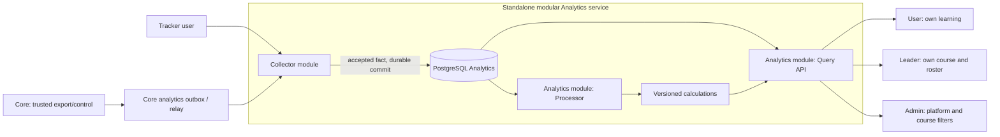

# Analytics: модульная архитектура и план реализации

Редакция 16.11.2026 после опроса владельца. Каноническая карточка: [CORP-438](https://platformpy.atlassian.net/browse/CORP-438), справочные решения CORP-110/111/112. Ветка `feach/Analitick`. Это обновлённый план: новый Analytics, Tracker, миграции и deployment этим документом не реализованы.

## 1. Принятые продуктовые решения

Исполнение начато16.11.2026 по поручению владельца. Подэтап1.1 принят отдельными
карточками; реализация и фактические проверки записываются в Jira и
`docs/analytics/EXECUTION.md`. Архитектурная приёмка438 не означает готовность
инфраструктурного gate109 или разрешение перехода через незавершённый Core56.

1. В первом продуктовом релизе наблюдаемая учебная активность собирается только для роли `user`. Ведущие и администраторы читают разрешённые отчёты об учениках. Метрики их собственной работы и новое логирование их операций — отдельный будущий объём. Действующий операционный аудит Core сохраняется.
2. Время урока разделяется на `theory` и `practice`; отдельный третий разрез «код» не вводится, работа в редакторе относится к практике. Учебный урок отличается от личной встречи с ведущим.
3. Учитывается видимый учебный контекст в фокусе: активная панель theory/practice. Скрытая вкладка, потеря фокуса учебного контекста и sleep не добавляют время. После 5 минут бездействия учёт останавливается; чтение до этой границы учитывается. Новое действие возобновляет учёт с текущего момента, без добавления паузы.
4. Параллельные вкладки, панели и устройства не умножают время. В каждый момент выбирается один контекст пользователя; теория плюс практика дают общее время, не дополнительное время поверх него.
5. Одна общая таблица `activity_facts` для первичных фактов учебной активности всех курсов. Разрезы по курсу, уроку, пользователю и периоду получаются фильтрами и расчётами. Таблицы посещений каждого курса и обязательные копии данных каждого модуля не создаются.
6. Главные показатели: уникальные посетители, активное учебное время, учебный прогресс. Прогресс подтверждает Core, а не браузерный таймер. Подписки, квоты, записи и личные встречи — операционные факты Core.
7. Прежний визуальный каркас панелей сохраняется. На курсе один ведущий, заданный `leader_user_id` в манифесте. Назначения ведущих и переносы через UI/API не входят в этот объём.
8. При запуске разработки 16.11.2026 владелец выбрал хранение подробных фактов посещений и времени без автоматического TTL. Удаление аккаунта/subject обязательно и не зависит от срока. CORP-69 фиксирует технические сроки, grant/revocation и delete/restore contract; первый инфраструктурный этап использует synthetic данные.

Локальный миниспринт CORP-526/534 принят 16.11:669 backend и137 frontend тестов, браузерная приёмка; это не подтверждение production-готовности Core или инфраструктуры Analytics. Входные роли и курс/roster передаются из готового Core-контракта, повторная реализация ролей внутри Analytics не нужна.

## 2. Три модуля сервиса и единицы запуска

Analytics — самостоятельный модульный backend относительно Core. Сохраняются три верхнеуровневые зоны ответственности прежнего Jira-плана: **Сборщик / Collector**, **Аналитика**, **PostgreSQL Analytics**. PostgreSQL здесь — модуль хранения/инфраструктурная граница, а не ещё один сервис бизнес-логики.

| Модуль | Внутренние обязанности | Публичная граница | Масштабирование |
| --- | --- | --- | --- |
| Сборщик / Collector | Проверка источника и разрешений, схемы/лимиты, dedup/conflict, durable приём, ACK | Versioned batch API и контракт принятого факта; без расчёта KPI | Отдельные stateless collector replicas, собственные ресурсы/pools/probes |
| Аналитика | Нормализация времени; формулы посетителей/времени; доверенные проекции Core; отчёты и ACL | Контракты обработки и Query API; без записи в Core и без зависимости от внутренностей Collector | Processor workers и Query API запускаются/масштабируются отдельно |
| PostgreSQL Analytics | Общие activity_facts, индексы, технические checkpoints/jobs/fences, backup/restore | Storage-порты и собственная migration history, отдельные DB/roles | Бюджет CPU/RAM/IOPS/connections; один primary записи, вынос DB endpoint по необходимости |

Три прикладных entrypoint: `collector`, `processor`, `query`; мигратор — отдельная команда/Job. Processor не стартует скрыто внутри Collector или HTTP worker. Один runtime image допустим; настройки, лимиты, connection pools, probes и replica count отдельных entrypoints независимы. Нет требования создавать отдельный процесс, базу или таблицу на каждую внутреннюю функцию.

Разные модули связываются опубликованными контрактами и портами, а не импортами чужих API handlers/ORM и прямой записью в чужие таблицы. Изменение одного модуля проверяется контрактными fixtures его consumers. На первом профиле транспорт внутри сервиса — PostgreSQL; новый брокер/Redis без доказанной необходимости не добавляется.

### Внутри Сборщика

* `admission`: проверка token/source, server-owned subject и product scope, версии схемы и лимитов.
* `acceptance`: producer namespace + event_id, canonical payload hash, duplicate/conflict, одна транзакция приёма и ACK после commit.
* `transport`: batch API, per-item ответы, backpressure, bounded retry contract. Браузер не ждёт сетевого ответа для навигации.

Collector не вычисляет длительность обучения по своим HTTP запросам, не принимает browser progress как доверенный и не отдаёт отчёты. Ограничение роли user относится к учебной browser telemetry; внутренние подтверждённые Core control события каталога/удаления/прав имеют отдельный доверенный контракт.

### Внутри Аналитики

| Внутренний модуль | Ответственность | Источник/результат |
| --- | --- | --- |
| `activity` | Граница 5 минут, theory/practice, объединение пересечений и attribution одному контексту | Принятые activity_facts → детерминированные допустимые интервалы |
| `metrics` | Посетители, время, дневные и курсовые разрезы, версии формул | Те же общие факты → ограниченные расчёты/ответы, без таблицы на каждый курс |
| `learning` | Только согласованные доверенные данные прогресса Core | Versioned Core export/events; не выводит завершение из таймера |
| `reports` | Фильтры, scope/ACL, сборка ответов, freshness/quality | Публичные порты activity/metrics/learning и Core read contracts |
| `catalog` | ID курса/урока, версии, aliases и названия | Минимальный Core manifest; материалы курса не импортируются |
| `privacy` | Lifecycle/tombstone, блокировка поздних фактов, удаление и restore barrier | Доверенные Core control события |

Это границы кода/контрактов и самостоятельного развития, а не обязательные отдельные таблицы статистики. Сборщик — единственный владелец записи неизменяемого принятого activity payload; Аналитика читает его через storage contract. Технический статус обработки и возможные производные результаты принадлежат своим владельцам; повторный расчёт не переписывает исходный факт.

Первый релиз использует общие факты и ограниченные запросы. Если измерения потребуют подготовленных read models, они версионируются и полностью восстанавливаются из исходных фактов. Обязательных rollup/contribution таблиц, новых KPI или median на старте нет. Тяжёлый расчёт уходит в Processor, не в HTTP event loop; сортировки/периоды/объём Query ограничены.

### Целевой layout

```text
services/analytics/
  pymentor_analytics/
    app/                     composition; collector/processor/query entrypoints
    modules/
      collector/
        api/                 versioned batch transport
        application/         admission/acceptance, transaction boundary
        domain/              invariants, event types
        ports/               storage/auth contracts
      analytics/
        activity/            интервалы, idle, attribution
        metrics/             формулы и разрезы
        learning/            только доверенный прогресс Core
        reports/             query API и разрешённые DTO
        catalog/             безопасные ID/версии
        privacy/             deletion/replay/restore barriers
    adapters/                PostgreSQL, verifier, observability
    shared/                  минимальные типы; без Core ORM
  contracts/                 OpenAPI/JSON schemas, module fixtures
  migrations/                собственная Alembic history
  tests/                     modules/contracts/recovery/architecture
  Dockerfile                 отдельные команды ролей/migration
infra/helm/analytics/         отдельный release и ресурсы entrypoints
infra/gitops/analytics/       самостоятельная доставка
```

Пути целевые, каркас пока не создаётся. Ограничения импортов проверяются architecture test; внутренний модуль может стать отдельным сервисом позднее только через явный контракт/backfill/parity/cutover. Смена процесса не меняет partition key или business identity; перенос через разные БД требует нового outbox/inbox, а не одной смены DSN.

## 3. Потоки данных



Results обозначает результаты расчётов/публичный порт, не обязательную новую таблицу или отдельный сервис. Core accounts/access/catalog/authoritative progress, subscriptions/booking и notification outbox остаются в Core. Общая таблица activity_facts — единственный первичный источник новой активности, а не универсальная замена всех бизнес-данных.

Нет Core ORM imports, cross-service SQL/FK/FDW, доступа Analytics к Core Redis или монтирования Python/материалов курсов. Передаваемые прогресс и каталог — versioned минимальные DTO; Analytics не становится владельцем их исходной истины. Отчёт может показывать время Analytics и подтверждённый прогресс из согласованного Core export/read contract с отдельной свежестью.

Остановка, обновление или replay Analytics не должны блокировать Core login/navigation/submit/progress в пределах рассчитанного окна автономности. Core producer добавляется только на этапе2: отдельный analytics outbox в бизнес-транзакции, отдельный relay, at-least-once и ограниченный storage budget. Notification/Telegram очередь не переиспользуется; синхронный вызов Analytics из бизнес-транзакции запрещён.

## 4. Общие факты и контракты

### Первичная activity_facts

| Группа | Целевые поля/смысл |
| --- | --- |
| Идемпотентность | producer namespace, event_id, schema_version, immutable payload hash |
| Ученик | Непрозрачный subject_ref lifecycle UUID; не email и не cookie/session token |
| Контекст | product course_id, lesson_id, catalog_version; section=theory/practice для времени |
| Тип факта | Вход на курс или интервал активности урока; вход может иметь lesson_id/section=null и active_ms=0 |
| Время | session_id отдельной учебной сессии, started_at/ended_at, active_ms, received_at сервера |
| Качество | Источник/версия, полнота/причина ограничений, необходимые технические сведения о приёме |

Служебный session_id не является auth session ID. Body не выбирает чужой subject или роль. Collector проверяет роль/доступ из доверенного grant и актуальные control ограничения; ложный role=user в payload не разрешает приём. Тестовые аккаунты инфраструктуры явно synthetic и не смешиваются с real-data pipeline.

Факт входа позволяет считать посетителя без активных учебных секунд. Отчёты времени используют допустимые интервалы после нормализации; принятый raw payload не доказывает фактическое изучение. Общий счётчик людей — distinct subject_ref, не сумма distinct по курсам.

### Время и минимальные формулы

* При видимом учебном контексте в фокусе отсчитываются подтверждённые интервалы. После 300 секунд от последнего действия время обрывается на этой границе, последующая пауза не добавляется при возвращении. Sleep/скрытие/потеря фокуса учебного контекста/смена пользователя закрывают интервал. Cadence, max segment, clock-skew и lateness задаются до реализации в CORP-58/59/113.
* В Dockview учитывается одна активная панель: theory либо practice. Редактор и выполнение учебного задания входят в practice. Общий час не удваивается ни по панелям, ни по устройствам/курсам. Нормализация последовательна по subject_ref; конкурирующие контексты имеют детерминированный tie-break.
* Посетители за период: число разных учеников с принятым фактом входа на курс/учебной активности в выбранном окне. Две вкладки и два курса одного ученика дают одного платформенного посетителя.
* Активное время: сумма допустимых неперекрывающихся интервалов, с разрезами theory/practice. Полночь разделяет интервал по дням, а не переносит его весь в одну дату.
* Учебный прогресс: подтверждённые завершения уроков/заданий из Core, не browser click и не превышение времени. Сравнение времени не объявляется оценкой успеваемости.
* Первый UI день — Москва/UTC+03:00, как действующий Core calendar. Хранение timestamps UTC. Новые TZ/DST правила требуют отдельной версии метрики; старые ответы не меняются молча.
* Имена источника, версии формул, population, units/период и coverage зафиксированы. No data, zero, stale и unavailable различаются; исторические activity days не превращаются задним числом в минуты или course visits.

### Доставка и восстановление

Collector валидирует envelope/source/limits, сохраняет принятый факт и действительно необходимые технические jobs атомарно, ACK только после durable commit. Per-item accepted/duplicate/rejected/conflict, same key+different payload=conflict, retry при неизвестном commit с тем же event_id. received_at не входит в payload hash. PostgreSQL durability не отключается для улучшения latency.

Browser не может объявлять payment/progress/deletion или trusted Core source. Серверные факты и control — отдельный credential/route. 429/Retry-After,503, unsupported schema и максимальные размеры описаны в контракте. Browser tail имеет best-effort границу до durable ACK; это не обещание полного учёта каждой секунды при аварийном закрытии устройства.

Для асинхронной работы используются стабильные consumer/version/partition, bounded claim, lease и fencing. Поздние события не отбрасываются по одному high watermark; live/replay имеют отдельные лимиты. Worker commit проверяет subject epoch и lease generation под конфликтующими locks; ACK/effects/dedup и downstream technical jobs атомарны. Poison event — quarantine с причиной и ограниченным retry, не скрытый success.

Отдельная работа CORP-113 рассчитывает объём Core outbox и автономное окно (24ч — прежний кандидат, не утверждённый SLO), warn/critical/drain и действия оператора. Бесконечная автономность при конечном диске не обещается; подтверждённые факты не теряются молча.

## 5. Представления по ролям и основной UI

| Читатель | Разрешённые данные | Первая версия экранов |
| --- | --- | --- |
| User | Собственные данные по разрешённым курсам | Время за день/неделю/месяц, theory/practice, уроки и подтверждённый прогресс, календарь активности |
| Leader | Только назначенный курс и разрешённые личные ученики по Core booking roster (past/current/future/cancelled) | Прежние Обзор/Аккаунты/Слоты/Календарь; в обзоре показатели аудитории, в карточке ученика время/уроки/прогресс/последняя активность |
| Platform admin | Учебные данные пользователей платформы, любой явно выбранный курс | /admin-platform: общая картина, сравнение/фильтры курсов и переход к ученику/уроку; без собственного курса/преподавательского календаря |

Главные карточки: уникальные посетители, активное время, учебный прогресс. Ниже — графики по дням, таблицы уроков и учеников. «Ещё не начинал» отличается от «давно не возвращался». Фильтры период/course/lesson для активности и посетителей используют общие activity_facts; прогресс — доверенный Core contract с теми же согласованными фильтрами и серверным scope. При несовпадении audiences показатели не выдаются за сравнимые.

Подписки остаются общими: один подписчик двух курсов — один платформенный подписчик. Расписание/балансы/личные встречи берутся из Core и не становятся учебным временем. Отчёты ведущему об учениках входят в базовый обязательный этап3; CORP-452 остаётся дополнительным расширением этих отчётов, а не prerequisite их первой версии. Метрики работы самих ведущих/администраторов и новые логи их операций не являются CORP-452 и не входят в первый сбор.

## 6. Авторизация, каталог и приватность

Core выдаёт узкий короткоживущий Analytics grant. Collector/Query проверяют подпись локально: фиксированный algorithm allowlist, iss/aud/exp/nbf/kid/sub, source/scope/course permissions; ключи заранее с overlap. Сроки grant/revocation SLA уточняет CORP-58/69; прежние collection5мин/reports60сек — кандидаты, это не idle правило300сек. Нет синхронной introspection Core/Redis на каждый batch/query.

Учебный collection разрешён только user; отчёты разрешены всем трём ролям в своей области. Lookup пользователя через grant-search для выдачи не предоставляет leader право на его полный Analytics профиль. Student ID/course/filter из URL не расширяет grant. Expired/unknown key/forged source — deny. Query tokens в памяти, Authorization header, ограниченный CORS; cookies/токены не попадают в facts/logs. Отзыв Core прав и задержка bounded Analytics grant различаются; мгновенный отзыв не объявляется реализованным без отдельного барьера.

Стабильный адрес урока — (product course_id, lesson_id), задания — с task_id/revision, плюс catalog_version и исторический track_id. backend/backend_copy могут иметь одинаковые lesson IDs. Core публикует минимальный manifest/snapshot/delta; неизвестная версия идёт в pending/quarantine, история не присоединяется к похожему названию. Старый c226 course_id=track ID требует явного v1→v2 mapping, не молчаливой подмены.

В facts нет кода/ответов, закрытых тестов, stdout, контактов, содержимого клавиш, записей экрана, паролей, bearer/cookie, полных URL/query. IP/UA/referrer/устройства/география по умолчанию не сохраняются; необязательная ветвь CORP-451 отдельна. Имя в разрешённой UI карточке предоставляет Core, имя не копируется в учебный факт.

CORP-69 фиксирует сроки для фактов, личной истории, технических logs/buffer/backups/tombstones до real collection. Никакого автоматически принятого TTL30дней для прогресса или аналитики. Delete ставит durable tombstone/epoch: новые события и query старого lifecycle запрещены, даже при повторном использовании numeric ID/email. Worker/query/delete используют конфликтующие locks/CAS; старый worker или cache не публикует удалённый вклад. Если позднее есть общий rollup, его validity generation проверяется до выдачи; dirty результат недоступен до пересчёта.

Restore требует независимого authoritative deletion journal и актуального high-watermark вне восстанавливаемого snapshot. До догрузки удалений и проверки полноты API/workers закрыты. Tombstones живут дольше всех разрешённых backup/replay/offline окон; privacy lag/readiness имеет контракт. Изоляция и privacy проверяются на реальной disposable PostgreSQL, не только in-memory oracle.

## 7. Ресурсы и эксплуатация

Собственные DB, migration owner и ограниченные runtime roles. На первом VPS общий физический PostgreSQL instance допустим только как явный компромисс: отдельные logical DB/roles не дают физическую независимость CPU/disk/SPOF. Отдельный DB endpoint предусматривается; replicas приложений не масштабируют запись одного primary. Read replicas — позже по измерениям и с deletion/lag barriers.

Для каждого entrypoint/pool: bounded concurrency, batch size, pool+overflow, timeout/deadline, requests/limits, graceful drain. Суммарные replicas×processes×connections вместе с Core/Runner/relay и migration/admin/backup reserve укладываются в DB/CPU/RAM/IOPS budget. CPU-работа Processor отделена от event loop HTTP; отчёты не сканируют всю историю без окна/лимита.

Collector, Processor и Query получают отдельные команды/config/probes/ресурсы. Масштабирование одного не требует роста двух других или Core. На одном VPS нет обещания HA от дополнительных Pod. Вначале manual replicas; HPA/custom metrics только после adapter/permissions и измерений. Будущие модули могут получить отдельный pool по нагрузке без нового источника данных.

Собственный Helm/GitOps release, runtime/migration image с digest и CI path filter для services/analytics. Separate namespace/Secrets/NetworkPolicy/quotas и права AppProject проверяются в CORP-439–442. Только точные внешние маршруты /api/analytics/events/batch и /api/analytics/reports/*; Core /api и AI Mentor маршруты не перехватываются. Processor/DB/control endpoints не публикуются.

Наблюдаемость сервиса: accepted/rejected/duplicate/conflict, p95 intake/query, durable commit, backlog/oldest age, retry/quarantine, fencing conflicts, freshness/deletion lag, pool saturation и storage. Это техническое здоровье сервиса, не персональные KPI сотрудников.

## 8. Три глобальных этапа и Jira

Существующие ключи, parent hierarchy, Blocks, sprint membership, даты и статусы сохраняются. Этим поручением обновляется план, выполнение Analytics/деплой не начинается.

| Этап | Существующий объём | Вход → выход |
| --- | --- | --- |
| Этап 1 — Инфраструктура, CORP-2 | CORP-438 архитектура/контракты;439 каркас/хранилище;440 Collector;441 Processor/replay/privacy;442 ресурсы/restore | Core роли CORP-534 локально приняты → инфраструктурный gate CORP-109 по собственным evidence |
| Этап 2 — Совместимый перенос, CORP-436 | CORP-443–446: согласованные существующие Core расчёты/история/API, надёжный producer и parity/rollback | CORP-109 + фактический Core gate CORP-56 → CORP-454 |
| Этап 3 — Tracker, KPI и UI, CORP-437 | CORP-447 time tracker;448 нормализация/метрики;449 user/leader/admin API/UI;450 E2E/load/приёмка | CORP-454 и решения privacy → CORP-119 локально; CORP-122 после отдельно разрешённых серверных проверок |

В инфраструктуре используют synthetic producer и synthetic module handlers. Они проверяют независимость Collector/Processor/Query/DB, не означают ранний запуск реального Tracker или построение всех продуктовых отчётов. Старый user_activity_days и действующие calendar/streak/admin summaries сохраняются до совместимого переноса; старые дни не backfill в минуты и course attribution.

Внутри CORP-438 текущие задачи:
* CORP-57 — три модуля, внутренние порты/layout/ownership, изоляция и scale matrix.
* CORP-58 — факт/section/source/schema, batch ACK, роль user для collection и три роли для read, Core/control contracts.
* CORP-59 — пауза300сек, theory/practice, union/context attribution, три главных KPI и golden cases.
* CORP-60 — product/lesson identity, catalog/version/legacy mapping.
* CORP-69 — доступ/retention/revocation/deletion/restore, staff scope отдельно.
* CORP-113 — численные budgets и profile10–15→25/50; независимые Collector1→2, Processor1→2 и Query1→2 измерения.

Новые карточки и дополнительные подзадачи не создаются. CORP-451/452/453 остаются необязательными ветвями устройств/расширенных отчётов/крупного роста после первого релиза. Дополнительные cohort/retention/median/popularity KPI не включаются автоматически. Для производительности прежние p95 Collector≤300мс, Query≤500мс, lag≤60с — кандидаты CORP-113, не утверждённые/измеренные обещания.

## 9. Проверяемая приёмка плана и будущих реализаций

Все следующие runtime сценарии — PROPOSED, с владельцем, dataset, expected/actual и версией до исполнения. CORP-438 закрывается по собственным проверенным артефактам57/58/59/60/69/113, не по одному изменённому описанию.

1. **Модульность:** Collector/Analytics/PostgreSQL видны в C4 и layout; Processor/Query раздельны; module import/contract test запрещает Core imports и приватные межмодульные зависимости. Остановка Query или одного compute pool не останавливает приём.
2. **Роли:** Collector отвергает staff учебную telemetry и поддельный role=user; user видит себя, leader только курс/booking roster, admin видит учебные user данные глобально/с фильтром. Операционный аудит Core сохраняется; staff performance/logging не внедрён.
3. **Время:** 8мин без действий на видимом уроке в фокусе дают максимум5мин до паузы; скрытие/потеря фокуса/sleep не добавляют секунды, действие возобновляет с текущего момента. ПодтверждённыеTheory8+practice12+другойкурс10 дают20 в первом курсе,30 на платформе и1 посетителя. Перекрытия вкладок/устройств не удваивают результат.
4. **Доставка:** crash до/после commit, потерянный ACK, duplicate/conflicting payload, late/offline/reorder, неизвестный catalog/schema — предсказуемый результат без двойного времени и молчаливой потери подтверждённого факта.
5. **Синтетическая инфраструктура:** Core/Redis/Runner/course files отсутствуют, synthetic issuer/producer → Collector → общие факты → Processor handlers → Query. ≥2workers, lease takeover/stale writer и replay сверяются с oracle.
6. **Совместимый перенос:** только после109+56, без изменения authoritative progress/accounts/оплаченных subscriptions; parity/cutover/возврат с сохранностью новых записей. Новый Tracker не prerequisite gate454.
7. **Продуктовые UI:** существующие user/course/platform панели показывают три KPI, theory/practice, real data и явные unavailable/stale. Backend ACL проверяется отдельно от скрытых кнопок. Desktop/mobile, смена user/course/role, delayed responses и поиск для выдачи.
8. **Privacy/recovery:** delete против worker/query/cache/late event/replay, новый lifecycle с прежним numeric ID; clean restore плюс актуальный внешний deletion watermark, incomplete journal удерживает выдачу закрытой.
9. **Ресурсы:** профиль10–15/25/50 + replay/backup, независимый рост entrypoints и budget/stop criteria. RTO/RPO/lag/latency измерены, увеличение replicas не объявляется ускорением без результата.

## 10. Источники и нерешённые значения

Источник продуктовых правил — ответы владельца16.11 и одобренное описание трёх представлений. Источник модульных границ/порядка — live CORP-110/111/112/438 и их существующие дочерние задачи, сверенные перед правкой. Локальный Core: services/core-api/pymentor_core, apps/web, courses/registry.json, course-package-v2, role-admin contract; аналитический baseline c226 остаётся synthetic предложением, не реализованной доставкой.

До реализации уточняются только технические параметры cadence/max segment/clock skew/lateness, утверждённые retention/grant revocation SLA и численный hardware/SLO budget. Правила роли user,5мин idle,theory/practice,единой таблицы и трёх представлений уже согласованы и не открываются заново.

Сохранённые технические первоисточники прежней редакции: [PostgreSQL16 locking](https://www.postgresql.org/docs/16/sql-select.html), [SQLAlchemy concurrent sessions](https://docs.sqlalchemy.org/en/20/orm/extensions/asyncio.html#using-asyncsession-with-concurrent-tasks), [Kubernetes HPA](https://kubernetes.io/docs/concepts/workloads/autoscaling/horizontal-pod-autoscale/). Их pins и применимость повторно проверяются при реализации. Сохранённые legacy архивы/backup не означают возврат новой версии Core к SQLite или dual runtime.
